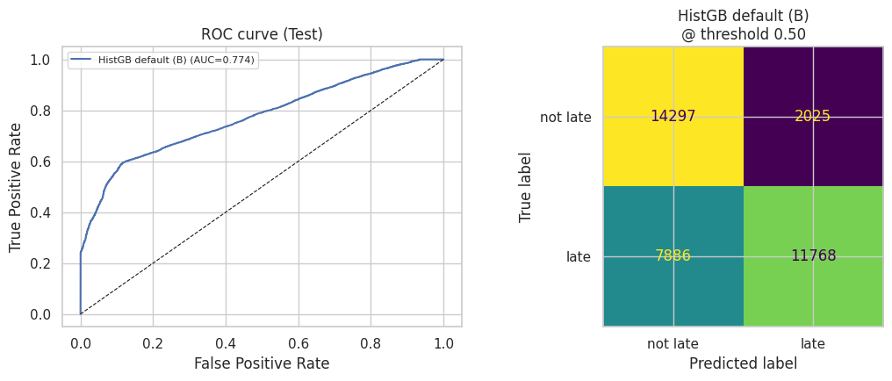
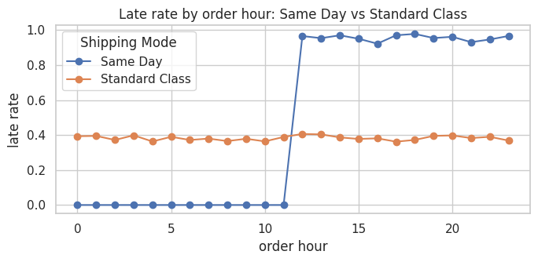

# Late Delivery Risk Prediction — DataCo Smart Supply Chain

Predicting whether an order will arrive late **using only information available when the order is placed**, so logistics teams can act before shipping. **Final model: HistGradientBoosting, Test ROC-AUC 0.774, late-order precision 0.853.**

---

## Repository Structure

```
.
├── data/
│   └── README.md                         # How to download the dataset (CSV not committed)
├── images/                               # Charts used in this README
├── notebooks/
│   └── late_delivery_risk_prediction.ipynb   # Full pipeline: EDA → leakage check → models → evaluation
├── .gitignore
├── README.md
└── requirements.txt
```

## Setup & How to Run

1. **Install dependencies**
   ```
   pip install -r requirements.txt
   ```

2. **Download the dataset** from [Kaggle](https://www.kaggle.com/datasets/saicharankomati/dataco-supply-chain-dataset) and place it as:
   ```
   data/
   └── DataCoSupplyChainDataset.csv
   ```

3. **Run the notebook**
   ```
   jupyter notebook notebooks/late_delivery_risk_prediction.ipynb
   ```
   - Set the environment variable `DATACO_PATH=../data/DataCoSupplyChainDataset.csv`, or edit the path in the first data cell.
   - Runs on CPU. The full notebook takes about 15 minutes; hyperparameter search alone takes about 7 minutes.

---

## Problem & Data

| Item | Detail |
|---|---|
| **Question** | From order-time information (payment type, shipping mode, destination, product, price, order time), can we predict late delivery? |
| **Target** | `Late_delivery_risk` (1 = late, 0 = not late), 54.8% / 45.2% |
| **Data** | 180,519 rows × 53 columns, 65,752 unique orders (Jan 2015 – Jan 2018) |
| **Metric** | ROC-AUC (primary), plus precision / recall for the late class |

## Final Methodology Summary

| Stage | Approach | Result |
|---|---|---|
| **Leakage check** | Dropped post-shipment columns (`Days for shipping (real)`, `Delivery Status`), personal data and IDs | Leaked column alone gave a misleading **93.6%** accuracy |
| **Data split** | StratifiedGroupKFold by `Order Id`: 80% train (5-fold CV) / 20% test | No order appears in both train and test |
| **Baselines** | Dummy; Logistic Regression on Shipping Mode only | ROC-AUC 0.500 / 0.726 |
| **Exp 1 — Feature engineering** | Set A (13 features) → Set B (20 features): removed high-cardinality city/state/ZIP, added `order_hour`, `is_weekend` | HistGB CV AUC **0.735 → 0.766** (+0.03) |
| **Exp 2 — Hyperparameter tuning** | RandomizedSearchCV, 15 settings × 5-fold group CV | CV AUC 0.766 → 0.768 (+0.002, within 1 SD) |
| **Exp 3 — Class weight & threshold** | `class_weight='balanced'`, threshold chosen on out-of-fold predictions | No gain (F1-macro ≈ 0.715 in all variants) |
| **Model selection** | Best CV AUC; if within 1 SD, choose the simpler/faster model | **HistGradientBoosting (default) on Set B** |

## Results

**Cross-validation (5-fold group CV, ROC-AUC)**

| Model | Set A | Set B |
|---|---|---|
| Logistic Regression | 0.733 | 0.740 |
| Random Forest | 0.731 | 0.764 |
| **HistGradientBoosting** | 0.735 | **0.766** |

**Final model on the test set (35,976 rows, threshold 0.50)**

| ROC-AUC | PR-AUC | Accuracy | Precision (late) | Recall (late) | F1-macro |
|---|---|---|---|---|---|
| **0.774** | 0.838 | 0.725 | **0.853** | 0.599 | 0.723 |

Test AUC (0.774) is in line with CV AUC (0.766), so there is no sign of overfitting.



## Key Findings

- **Features matter more than tuning.** Feature engineering added about 18× more AUC than hyperparameter tuning.
- **Three features drive predictions:** scheduled shipping days, shipping mode and order hour (permutation importance).
- **99.8% of missed late orders are Standard Class.** Recall is ≥ 0.998 for First Class, Second Class and Same Day, but only 0.009 for Standard Class, where the late rate stays near 38% at every hour.

  
- **Business value:** when the model flags an order as late it is right about 85% of the time, so teams can act on the alert. Reducing misses in Standard Class needs new data such as carrier or warehouse information.

---

## Reproducibility & Compliance

- **No test-set leakage:** all encoding and scaling run inside an sklearn `Pipeline`, and every choice was made on CV. The test set was used once, on the final model.
- **No personal data:** customer names, emails, passwords and addresses were removed before modelling, and the dataset is not committed to this repo.
- **Fixed random seed** (`random_state=42`) for splits and models.

## Team & Contribution

Group project (5 students), Practical Machine Learning course, Thammasat University — Nov 2026.

**My contribution: model tuning and optimization**
- Ran hyperparameter tuning for HistGradientBoosting with RandomizedSearchCV (15 settings × 5-fold group CV), searching learning rate, tree depth, leaf size and regularization.
- Tested class weighting and decision-threshold tuning on out-of-fold predictions, without touching the test set.
- Showed that tuning added only +0.002 ROC-AUC, less than fold-to-fold variation, which supported keeping the simpler default model and focusing on features instead.
